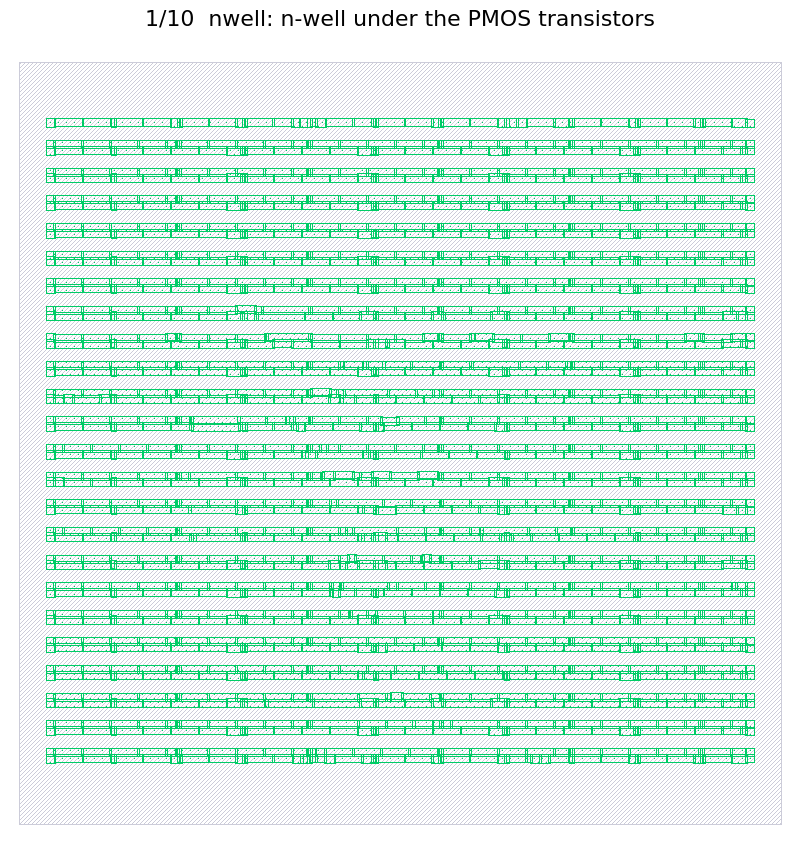

# 4-bit Array Multiplier: RTL to GDSII on SKY130

Sudhanva Joshi 2023102022

Aditya Peketi 2024122001

Repository: https://github.com/SudhuJ/arrayMultiplier

A 4-bit × 4-bit unsigned array multiplier (8-bit product) with registered inputs and output,
taken through RTL simulation, synthesis (Yosys), static timing analysis (OpenSTA) and place and
route (LibreLane) on the SkyWater SKY130 `sky130_fd_sc_hd` standard-cell library. All timing is
evaluated at the typical corner (tt_025C_1v80). The full write-up is in
[`report/report.pdf`](report/report.pdf).

## Results summary

| Stage | Result |
|---|---|
| RTL simulation | `PASS: 256 vectors checked, 0 errors` |
| Error-injection test (`sum = a ^ b`) | `FAIL: 256 vectors checked, 95 errors` |
| Synthesis | 61 cells, 16 flip-flops, 756.976 µm² (52.89 % flip-flops) |
| Gate-level simulation | `PASS: 256 vectors checked, 0 errors` |
| STA (typical corner) | Tmin = 2.79 ns, Fmax = 358.4 MHz, critical path `a_r[1]` → `p[6]` |
| Place and route (3.5 ns clock) | Setup slack +0.077 ns, post-route Fmax = 292.2 MHz |
| Signoff | 0 DRC errors (Magic, KLayout), 0 LVS errors (Netgen); hold slack +0.246 ns |
| Power (estimate, 3.5 ns clock) | 0.575 mW total; worst IR drop 0.72 mV |
| Layout | 150 × 150 µm die, 1882 instances, 2495 µm of wire |



## Design

- `rtl/full_adder.v`: 1-bit full adder written with `assign` statements.
- `rtl/mult_array.v`: registers `a` and `b`, builds the array from 16 AND gates and 12
  `full_adder` instances (three ripple-carry rows, `generate` loops, no `*` operator), and
  registers the product into `p`. All 16 flip-flops use an asynchronous active-low reset
  (`rst_n`). Latency is 2 clock cycles; throughput is one result per cycle.
- `tb/tb_mult.v`: exhaustive self-checking testbench. 10 ns clock, `rst_n` low for 2 cycles, all
  256 input pairs, a check after the 2-cycle latency, one line per mismatch, one PASS/FAIL
  summary line, and a `mult.vcd` waveform.

## Repository structure

```
README.md
rtl/
  full_adder.v
  mult_array.v
tb/
  tb_mult.v
synth/
  synth.tcl
  mult_array_netlist.v        (generated)
  mult_array_stat.rpt         (generated)
sta/
  sta.tcl
  mult_array_timing.rpt       (generated)
pnr/
  config.json
  metrics.json                (copied from the final run)
  mult_array.gds              (copied from the final run)
report/
  report.pdf
```

Simulation outputs go to `build/` and LibreLane runs go to `pnr/runs/`. Both are git-ignored.

## Environment

- RTL simulation: Icarus Verilog and GTKWave (run on the host).
- Synthesis, STA, place and route, and the gate-level simulation: the
  [IIC-OSIC-TOOLS](https://github.com/iic-jku/IIC-OSIC-TOOLS) container, which provides
  Yosys, OpenSTA, LibreLane, KLayout and the SKY130 PDK under `$PDK_ROOT`.
- Report: [Tectonic](https://tectonic-typesetting.github.io/).

All commands below are run from the repository root unless a `cd` is shown.

## Part A: RTL simulation

```
mkdir -p build/rtl
iverilog -g2012 -o build/rtl/sim tb/tb_mult.v rtl/full_adder.v rtl/mult_array.v
(cd build/rtl && vvp sim)
gtkwave build/rtl/mult.vcd
```

For the error-detection check, temporarily change `sum` in `rtl/full_adder.v` to `a ^ b` and
rerun the same commands. The testbench prints `FAIL: 256 vectors checked, 95 errors`. Undo the
change afterwards.

Waveform example (Sudhanva's roll number, A = 2 + 5 = 7, so B = 9): `b` becomes 9 at 2440 ns, the
inputs are captured at the rising edge at 2445 ns, and `p` becomes 63 at the rising edge at
2455 ns (2-cycle latency).

## Part B: Logic synthesis

Run inside the IIC-OSIC-TOOLS container:

```
yosys -c synth/synth.tcl

mkdir -p build/gls
CELLS=$PDK_ROOT/sky130A/libs.ref/sky130_fd_sc_hd/verilog
iverilog -g2012 -DFUNCTIONAL -DUNIT_DELAY=#1 -o build/gls/gls \
  tb/tb_mult.v $CELLS/primitives.v $CELLS/sky130_fd_sc_hd.v synth/mult_array_netlist.v
(cd build/gls && vvp gls)
```

| Metric | Value |
|---|---|
| Total cells | 61 |
| Flip-flops | 16 (`dfrtp_1`, 25.024 µm² each) |
| Total cell area | 756.976 µm² |
| Flip-flop area | 400.384 µm² (52.89 %) |
| Most-used cells | `dfrtp_1` × 16, `nand2_1` × 7, `maj3_1` and `and2_0` × 4 each |
| Netlist simulation | `PASS: 256 vectors checked, 0 errors` |

## Part C: Static timing analysis

Run inside the IIC-OSIC-TOOLS container. First run at T = 10 ns to find the worst slack, then at
Tmin = 2.79 ns (the default in `sta.tcl`), which writes `sta/mult_array_timing.rpt`:

```
PERIOD=10 sta sta/sta.tcl
sta sta/sta.tcl
```

| Metric | Value |
|---|---|
| Worst slack at T = 10 ns | 7.213 ns |
| Tmin | 10 − 7.213 = 2.787 ns, rounded to 2.79 ns |
| Fmax | 1000 / 2.79 = 358.4 MHz |
| Slack at T = Tmin | +0.003 ns |
| Critical path | `_91_` (`a_r[1]`) → `_88_` (`p[6]`), 8 logic cells |
| Latency | 2 × Tmin = 5.58 ns |
| Throughput | 358.4 million results/s |

## Part D: Physical design (LibreLane)

All timing is evaluated at the typical corner (tt_025C_1v80), as in Part C; `config.json` sets
`"STA_CORNERS": ["nom_tt_025C_1v80"]`. CLOCK_PERIOD = 1.2 × Tmin = 1.2 × 2.79 = 3.348 ns, rounded
up to the next 0.5 ns = 3.5 ns.

Run inside the IIC-OSIC-TOOLS container (with `PDK=sky130A`, e.g. after `sak-pdk sky130A`):

```
cd pnr
librelane --manual-pdk --pdk sky130A --scl sky130_fd_sc_hd --run-tag typical_3.5 config.json
cp runs/typical_3.5/final/metrics.json metrics.json
cp runs/typical_3.5/final/gds/mult_array.gds mult_array.gds
klayout mult_array.gds
```

| Metric | Value |
|---|---|
| CLOCK_PERIOD | 3.5 ns |
| Runs needed | 1 |
| Core area / die area | 17 759.5 µm² / 22 500 µm² |
| Cells after synthesis / after place and route | 61 / 1882 |
| Cells added | 1300 decap, 253 fill, 245 tap, 19 timing-repair buffers, 3 clock buffers |
| Wirelength | 2495 µm |
| Setup slack | +0.077 ns |
| Post-route Fmax | 1000 / (3.5 − 0.077) = 292.2 MHz (Part C: 358.4 MHz) |
| DRC / LVS errors | 0 / 0 |

### Run log

| Run | CLOCK_PERIOD (ns) | Corners | Setup slack (ns) | DRC | LVS | Result |
|---|---|---|---|---|---|---|
| 1 | 3.5 | typical (`nom_tt_025C_1v80`) | 0.077 | 0 | 0 | **Pass (final)** |

### Exploratory runs (LibreLane default, all 9 corners)

Before restricting signoff to the typical corner, these runs used LibreLane's default multi-corner
signoff. Each met timing at the typical corner, but failed at the slow corner (ss, 100 °C, 1.60 V).
They are recorded here for completeness; they are not part of the typical-corner flow above.

| CLOCK_PERIOD (ns) | Worst slack, all corners (ns) | Typical-corner slack (ns) | DRC | LVS |
|---|---|---|---|---|
| 3.5 | -2.184 | 0.511 | 0 | 0 |
| 4.0 | -1.684 | 1.011 | 0 | 0 |
| 4.5 | -1.184 | 1.511 | 0 | 0 |
| 5.0 | -0.682 | 2.011 | 0 | 0 |
| 5.5 | -0.208 | 2.509 | 0 | 0 |
| 6.0 | -0.154 | 2.877 | 0 | 0 |
| 6.5 | -0.224 | 3.117 | 0 | 0 |
| 7.0 | -0.137 | 3.518 | 0 | 0 |

## Report

[`report/report.pdf`](report/report.pdf) covers the design, all four parts with their results
tables, the block diagram, the waveform and layout figures, and the answers to the report
questions. It was compiled with [Tectonic](https://tectonic-typesetting.github.io/) from a LaTeX
source that is kept outside the repository.
